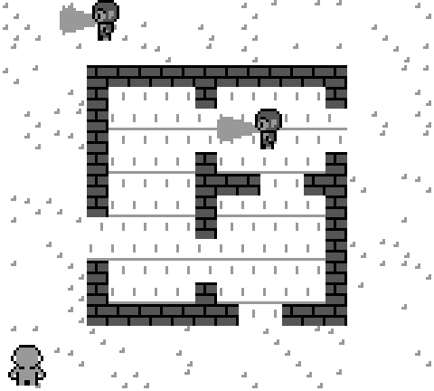
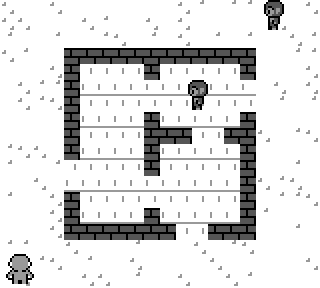

# Stealth prototype — real-time tactics for the Game Boy

A first prototype of a Shadow Tactics–style stealth game for the original Game Boy (DMG),
written in C with [GBDK-2020](https://github.com/gbdk-2020/gbdk-2020). It's about sneaking,
not fighting armies: you steer one character and must avoid the guards' view cones, or take
the guards down without being seen.

 

## Controls

| Button | Action |
|---|---|
| D-pad | Move in 8 directions (diagonals slowed to the same speed) |
| A | Take down an NPC within reach, unless it is attacking you |
| Start | Start the game from the title screen |
| A (after death or clear) | Restart |

## What's in the prototype

- **Map.** An open building in the middle of the screen with outer walls, three rooms
  inside, and doors between them and to the outside. There is room to walk around the
  outside.
- **Player.** Starts in the bottom-left corner. Uses the same diver sprites as Tether
  (GibbonGL's 8-direction template).
- **NPCs.** They use the same sprites, drawn one shade darker through the second sprite
  palette.
  - The **patrol** starts in the top-right corner and walks counter-clockwise round the
    house.
  - The **guard** stands in the top-right room, facing the door, and sweeps its view
    left and right.
- **View cones.** Each cone is 20 px long and 30° wide, drawn on the background in light
  grey. An NPC's facing turns smoothly in 256 steps, and the cone is drawn at 32 angles
  (11.25° apart). The sprite shows the nearest of its 8 directions. Walls block the view
  per 8×8 cell: a cell is lit only if no wall cell lies between it and the NPC's eye.
- **Three NPC states:**
  1. **Normal:** doing its duty, either patrolling or guarding.
  2. **Suspicious (`?`):** it glimpsed you, but you left the cone within 3 s. It leaves its
     duty and searches random spots around where it saw you for 8 s, then goes back.
  3. **Attack (`!`):** you were in its cone for 3 s. It moves to your last known position
     at full speed, and follows you as long as it keeps seeing you. If it reaches you, you
     die. If you're not there when it arrives, it looks around: if you're within 20 px (with
     line of sight) it goes for you again, otherwise it turns suspicious.
- While you're in a cone, the NPC stops and stares, and a blinking `?` shows the detection
  building up.
- NPCs find their way round walls and through doors using a breadth-first path search on
  the 8 px grid.

## Browser prototype (ahead of the ROM)

Design work happens in the browser first, so `web/stealth.html` is ahead of `stealth.gb`.
Open it in any browser; on a phone it shows a Game Boy–style console with touch controls.
It adds, among other things:

- a level select with 5 levels (including The Ravine and Guard Rotation, from sketches)
- 60 px view cones, dithered, with a detection time that shrinks the closer you are
- a one-slot inventory: shuriken, rope, trap, stone and coin
- dragging and tying up bodies, bushes to hide bodies and to crouch in
- scripted guard routes, including a relay of five guards that hand over their posts

The source is `web/template.html`; `python3 web/build.py` fills in the tile data from
`web/webdata.json` and writes `web/stealth.html`.

## Building

You need GBDK-2020 (tested with 4.x / SDCC 4.5) and `make`.

```sh
make                         # builds stealth.gb (32 KB, no MBC), with lcc on your PATH
make GBDK=/path/to/gbdk      # or point it at a GBDK-2020 folder
make gfx                     # regenerate src/gfx.c / gfx.h (Python 3 + Pillow)
```

## Tuning

These are the `#define`s at the top of `src/main.c`:

| Name | Default | Meaning |
|---|---|---|
| `SPOT_FRAMES` | 180 | Frames in a cone before attack (3 s) |
| `SEARCH_FRAMES` | 480 | How long a suspicious NPC searches |
| `PLAYER_SPEED` / `PATROL_SPEED` / `SEARCH_SPEED` / `ATTACK_SPEED` | 0.75 / 0.5 / 0.625 / 1 px per frame | Movement speeds |
| `TURN_RATE` | 3 | How fast NPCs turn (256 units per full turn) |
| `GUARD_SWEEP` | 40 | Guard looks ±56° around its facing |
| `KILL_DIST`, `TAKEDOWN_DIST` | 9, 12 px | Reach for a kill or a takedown |

The cone's length and width are set in `tools/make_gfx.py` (`CONE_LEN`, `CONE_DEG`). Run
`make gfx` after changing them. The cone renderer can handle cones up to about 24 px long
without changes.

## How it works

| File | Contents |
|---|---|
| `src/main.c` | Map, player, NPC state machine, path finding, sprites, title |
| `src/cone.c` | View cones drawn into a pool of background tiles |
| `src/vram.c` | VRAM write queue, emptied in vblank and in the h-blanks of idle lines |
| `tools/make_gfx.py` | Tiles, sprites, cone span tables and the cell line-of-sight table |

- **Cones are drawn in the background, not with sprites.** Each 8×8 cell a cone touches
  gets its own tile from a pool of 64: a copy of the floor tile with the cone ORed in. Floor
  tiles use only colours 0 and 1, so the cone can only lighten them.
- **Cones are stored as spans.** Each cone is precomputed as one pixel span per row, so
  drawing it means filling about 21 short spans, not 107 separate pixels.
- **Cones are redrawn only when they change,** and the work is spread over three frames:
  draw cone 1, draw cone 2, then upload. Only the tile bytes that changed are queued.
- **Detection uses the drawn cone.** It checks the player's 8×13 body box against the same
  spans and the same visibility cache, so what you see on screen is exactly what the NPC
  sees.
- **The hot loops are in SM83 assembly.** That covers span filling, cell visibility, the
  tile upload, the path search and the VRAM copy. The game holds 60 fps except for the odd
  frame.

## Credits

See [CREDITS.md](CREDITS.md). Character sprites: **"8-Directional Game Boy Character
Template" by GibbonGL** (CC0).
