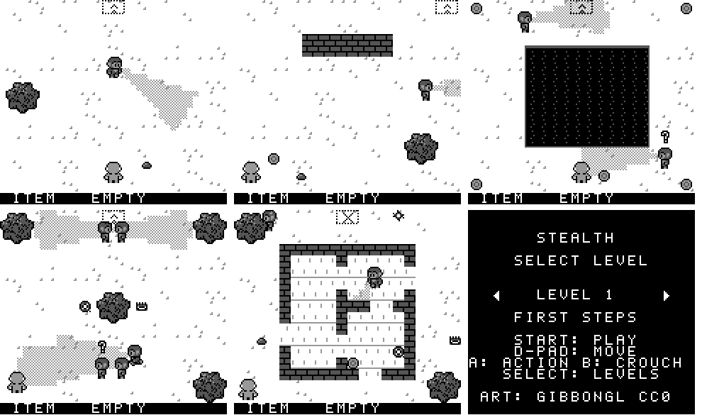
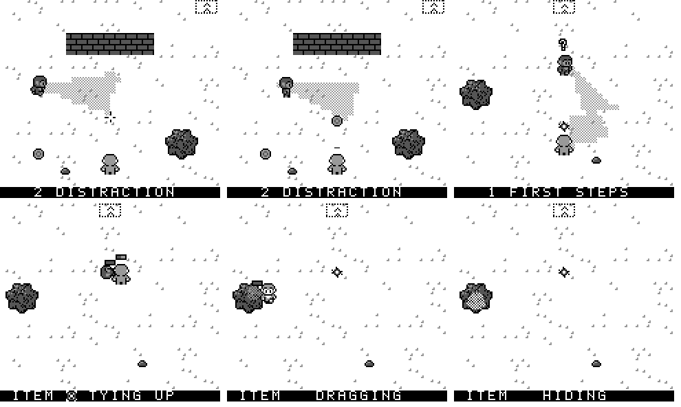

# Stealth — real-time tactics for the Game Boy

A Shadow Tactics–style stealth game for the original Game Boy (DMG), written in C with
[GBDK-2020](https://github.com/gbdk-2020/gbdk-2020). It's about sneaking, not fighting armies:
you steer one character past the guards' view cones, or take the guards down without being
seen. The design is worked out in the browser prototype (`web/`) and then ported to the Game
Boy; this ROM is **stage 3 of that port**: everything in the prototype is in.





## Controls

| Button | Action |
|---|---|
| D-pad | Move in 8 directions (diagonals slowed to the same speed) |
| A, empty-handed | Take down a guard within reach (a suspicious guard that sees you fights back) |
| A held, empty-handed | Drag a knocked-out body next to you |
| A with an item | Use it: throw the shuriken, set the trap, aim a stone or coin (D-pad moves the cross, let go to throw), hold next to a body to tie it up with the rope |
| A held 2 s, let go | Drop the item |
| B in a bush | Crouch / stand up |
| Left / Right, Start | Choose a level on the title screen, start it |
| Select | Back to the level select |
| A (caught / level clear) | Try again / next level |

## What's in the ROM (port stages 1 to 3)

- **Five levels** with a level select: First Steps, Distraction, The Ravine, Guard Rotation
  and The House, the same as in the browser prototype. Reach the exit (level 5's exit is
  locked for now: take everyone down instead).
- **Map cells:** ground, floor, walls (block walking and seeing) and the ravine (blocks
  walking only: guards see across it). **Bushes** to hide in.
- **Guard duties are scripts:** walk to a point, turn clockwise or anticlockwise, turn to a
  facing, and for Guard Rotation, bump signals so five guards hand over their posts in turn.
  Guards at a post sweep their view.
- **View cones** are 60 px long and 30° wide, checkerboard-dithered, cut off by walls, and
  sway ±10° while a guard walks.
- **Detection gets faster the closer you are:** 2.25 s at the far end of a cone, down to
  almost nothing right in front of a guard. Bumping into a guard kills you.
- **Guard states:** normal, suspicious (`?`, searches where it saw you), attack (`!`), and
  knocked out (a bar shows the 20 s until it gets up, suspicious). A guard that sees a
  knocked-out body searches around it.
- **Items** (one slot, shown in the bar at the bottom; walk over an item to take it, what you
  held is dropped and blinks for 4 s):
  - **Shuriken** flies straight ahead and knocks out the first guard it hits.
  - **Trap** is set in front of you; the next guard to step in it is knocked out.
  - **Stone** (thrown up to 60 px): guards within 50 px stop for 0.5 s, look at it for 4 s,
    then look back.
  - **Coin** (thrown up to 60 px, glints): a calm guard that sees it walks over, pockets it
    and walks back.
  - **Rope:** hold A next to a knocked-out guard for 4 s and it's tied up for good. Too slow
    and it wakes up and kills you.
- **Bodies:** drag them (A held, empty-handed); a body in a bush can't be seen, and a tied-up
  body left in a bush disappears.
- **Crouching in a bush** (B): calm and suspicious guards don't see you, and calm ones walk
  right past you. Attacking guards still do.

### How the Game Boy version differs

- **Cones are drawn per 4 × 4 px quarter-cell,** so their edges step in 4 px (the browser
  draws them per pixel). Detection uses exactly the same quarter-cells, so what you see is
  what the guards see.
- **Guards update every other frame** (half of them each frame) with double steps, so their
  speeds and timings are the same as in the browser.

## Browser prototype (ahead of the ROM)

Design work happens in the browser first, so `web/stealth.html` is ahead of `stealth.gb`.
Open it in any browser; on a phone it shows a Game Boy–style console with touch controls.
It adds, among other things:

- a level select with 5 levels (including The Ravine and Guard Rotation, from sketches)
- 60 px view cones, dithered, with a detection time that shrinks the closer you are
- a one-slot inventory: shuriken, rope, trap, stone and coin
- dragging and tying up bodies, bushes to hide bodies and to crouch in
- scripted guard routes, including a relay of five guards that hand over their posts

The source is `web/template.html`; `python3 web/build.py` fills in the tile data from
`web/webdata.json` and writes `web/stealth.html`.

## Building

You need GBDK-2020 (tested with 4.x / SDCC 4.5) and `make`.

```sh
make                         # builds stealth.gb (128 KB, MBC5), with lcc on your PATH
make GBDK=/path/to/gbdk      # or point it at a GBDK-2020 folder
make gfx                     # regenerate src/gfx.c / gfx.h (Python 3 + Pillow)
make CFLAGS+=-DPROF          # (testing: per-frame timing counters, see prof[] in main.c)
```

## How it works

| File | Contents |
|---|---|
| `src/main.c` | Map, player, guard state machine and route scripts, path finding, sprites, title (bank 0) |
| `src/items.c` | Items, the item bar, throwing, stones and coins, dragging, tying, crouching (bank 3) |
| `src/world.h` | Game state shared by `main.c` and `items.c` |
| `src/levels.c` | The five levels: maps, spawns, exits, guards and their route scripts |
| `src/cone.c` | View cones, drawn by swapping background tiles per quarter-cell (bank 1) |
| `src/vram.c` | VRAM write queue, emptied in vblank |
| `tools/make_gfx.py` | Tiles, sprites, lit tile variants, cone tables, line-of-sight table: writes `gfx.c` (bank 0), `gfx_cone.c` (bank 1), `gfx_tiles.c` (bank 2) |

- **Cones are background tiles, not sprites.** The play area is 40 × 34 quarter-cells of
  4 × 4 px. A cone is the set of quarter-cells whose centre lies inside it (a table per facing
  angle, 64 angles), minus those a wall hides. Each quarter-cell keeps one bit per guard. A
  cell shows one of 16 pre-made lit variants of its tile (checkerboard dots on the light
  pixels), so moving a cone only rewrites map entries: one byte per changed cell.
- **Moving a cone is a merge** of the old and new quarter-cell lists (both sorted), so only
  the quarter-cells that change are touched and a cone never blinks while it moves.
- **A frame budget keeps 60 fps.** Cone updates run last in the frame and stop at a fixed
  scan line; whatever is left continues next frame. Path finding starts only early in a
  frame and also stops in time. The game holds 60 fps on all five levels, with an odd
  dropped frame.
- **128 KB cartridge (MBC5), 4 banks of code and data.** Bank 0 holds the game loop and
  everything called every frame; the cones and their tables are in bank 1, tiles in bank 2,
  items in bank 3.
- **Bushes are background tiles** (three sets, for the offsets the levels use). A guard
  standing in one is drawn behind the leaves with the sprite priority bit; you crouching, or a
  body, show through as dithered sprites.
- **Line of sight** uses a table of the cells between two cells (one octant, mirrored), with
  a per-guard cache for its current eye cell. Levels without walls skip it.
- **Path finding** is a breadth-first search on the 8 px grid, written in assembly. Guards
  share three distance fields: a guard holds one only while it walks somewhere.

## Credits

See [CREDITS.md](CREDITS.md). Character sprites: **"8-Directional Game Boy Character
Template" by GibbonGL** (CC0).
