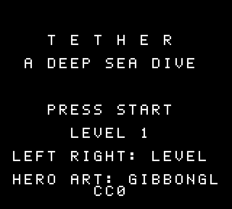
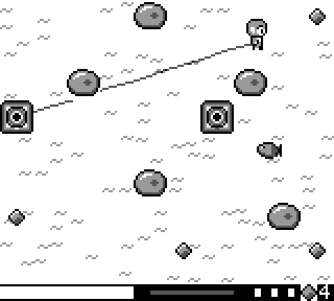

# Tether — a deep-sea dive for the Game Boy

A small Game Boy (DMG) game written in C with [GBDK-2020](https://github.com/gbdk-2020/gbdk-2020).

You play a diver collecting gems from the sea floor. Your air comes down a hose from a
water pump. The hose runs in a straight line and catches on rocks, so you have to think
about the route you take out and back.

 

## How to play

| Button | Action |
|---|---|
| D-pad | Swim (diagonals are slowed to the same speed) |
| Start / A | Start the game, retry after drowning |
| Left / Right on the title | Choose the starting level |

- **Hose.** The hose has a fixed length for each level. When it's fully paid out you can
  only move back toward the line. When you walk back, the slack reels in.
- **Rocks.** If you swing the hose across a rock it catches there, and the hose then
  continues straight from that rock. Walk back around the rock to free it.
- **Pumps.** Touch another pump to switch to it. The hose reels in from the old pump to
  you (this uses air), then attaches to the new one.
- **Air.** The meter starts at 100 and doesn't refill. It drains while the hose is
  reeling in, and through every hole in the hose.
- **Fish.** Fish patrol some rows. If one reaches the hose it stops, lunges, and bites.
  The hose takes 3 bites (the pips on the HUD); after that every bite makes a leaking hole.
- **Finishing a level.** Collect every gem, then return to the start pump. You're
  lifted out on the hook.
- There are five levels. Each one has more rocks, fish and pumps, and a shorter hose.

The HUD at the bottom shows, from left to right: air, how much hose is paid out, hose HP
and the number of gems left.

## Browser prototype

`web/tether.html` is the phone-playable browser prototype the Game Boy version was designed
from. Open it in any browser; on a phone it shows an on-screen D-pad and buttons.

## Building

You need GBDK-2020 (tested with 4.x / SDCC 4.5) and `make`.

```sh
make                         # builds tether.gb, with lcc on your PATH
make GBDK=/path/to/gbdk      # or point it at a GBDK-2020 folder
make clean
```

The ROM is a 32 KB DMG cartridge with no MBC. It runs on real hardware and in any
emulator (SameBoy, Emulicious, BGB, mGBA, PyBoy…).

### Graphics

`src/gfx.c` and `src/gfx.h` are generated, so don't edit them by hand. To regenerate them
(needs Python 3 and Pillow):

```sh
make gfx
```

`tools/make_gfx.py` cuts the diver's frames out of `assets/hero.png` (GibbonGL's
template). It draws everything else in code: the seabed, rocks, pumps, fish, bubbles,
gems, hook, HUD and font.

## How it works

| File | Contents |
|---|---|
| `src/main.c` | Game states, movement, the hose chain (wrapping and unwrapping on rocks), fish, air, bubbles, sprites, HUD, title |
| `src/hose.c` | Drawing the hose into background tiles |
| `src/levels.c` | The five level maps |
| `src/game.h` | Shared constants and the hose API |
| `tools/make_gfx.py` | Graphics generator |

Some technical notes:

- **The hose lives in the background, not sprites.** A Game Boy shows at most 10 sprites
  per line, which isn't enough for an arbitrary line. Instead, the cells the hose crosses
  get their own tile copies from a pool of 128 tiles. The seabed uses only colours 0 and
  1, so the hose is drawn into the tiles' high bit-plane. Each pool tile keeps two layers:
  a *fixed* layer (pump → rocks, which rarely changes) and a *live* layer (last rock →
  diver).
- **VRAM writes are queued.** Changed bytes are queued and copied during vblank, so the
  game never waits on the LCD.
- **The work is spread over frames.** Clearing the hose, drawing it and uploading the
  tiles each run for as long as the current frame's time budget allows (judged by the LCD
  scanline), then continue in the next frame. The game keeps running at 60 fps; on busy
  frames the hose catches up a few frames later.
- **No multiply or divide in the hot paths.** The code uses a squares table,
  quarter-square multiplication, `isqrt` by table search, and incremental cross products
  for rock wrapping (each 1 px step changes every rock's cross product by ±x or ±y).
- **Assembly for the inner loops.** The line rasteriser, cell lookup, tile commit and
  VRAM copy are written in SM83 assembly.

Tuning values (air drain, reel speed, hose HP, glimmer timing…) are `#define`s at the
top of `src/main.c`.

## Credits

See [CREDITS.md](CREDITS.md). Diver sprites: **"8-Directional Game Boy Character
Template" by GibbonGL** (CC0).
